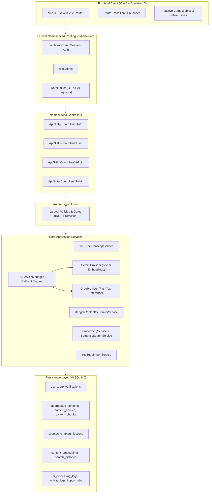
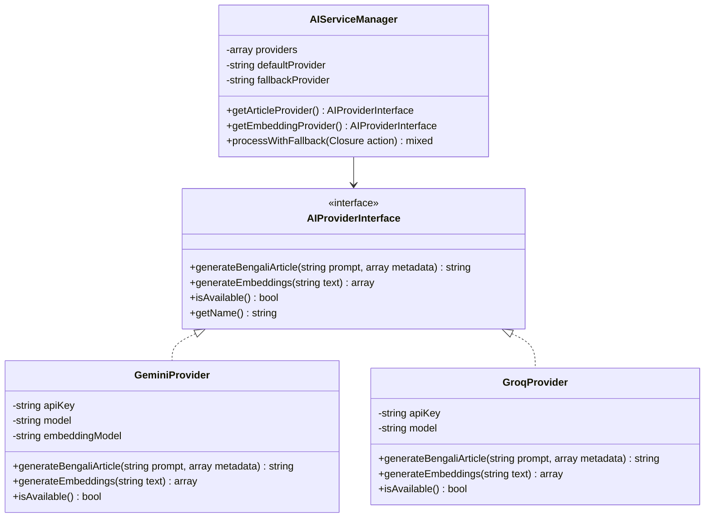
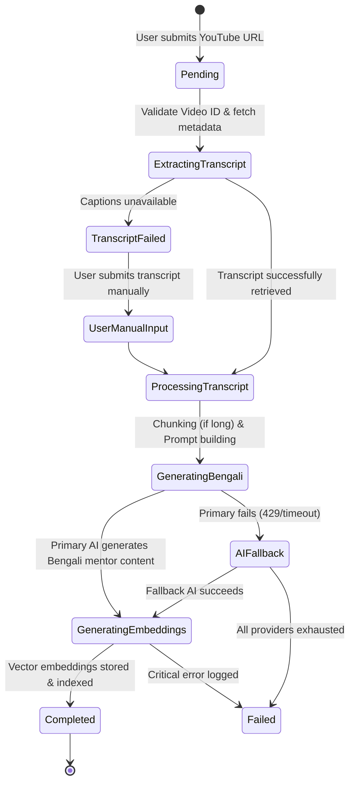
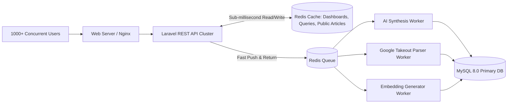

# AmarSocialContent - System Architecture Document

## 1. High-Level Architecture Overview

AmarSocialContent is architected as a clean, decoupled full-stack application with a Laravel RESTful backend and a modern Vue 3 Single Page Application (SPA) styled exclusively with Bootstrap 5 and Bootstrap Icons.



---

## 2. Decoupled AI Integration Subsystem

To ensure high availability, zero vendor lock-in, and resilience against quota limits or outages, the AI layer implements the **Strategy Pattern** managed by an `AIServiceManager`.



### Provider Responsibilities:
1. **Google Gemini (`GeminiProvider`)**:
   - Primary text generation model: `gemini-1.5-flash` or `gemini-2.5-flash`.
   - Vector Embedding model: `text-embedding-004` (768 dimensions).
2. **Groq (`GroqProvider`)**:
   - Text generation fallback: `llama-3.3-70b-versatile` or `mixtral-8x7b-32768`.
   - Used when Gemini returns `429 (Rate Limit)` or `503 (Service Unavailable)`.
   - *Note*: Groq specializes in ultra-fast LLM text inference; embeddings are handled exclusively by the embedding-capable provider (Gemini).

---

## 3. YouTube Content Ingestion & Bengali Transformation Pipeline

The aggregation pipeline converts raw video URLs into rich, structured Bengali educational articles through distinct states:



### Processing States:
- `pending`: Record created, awaiting job execution.
- `extracting_transcript`: Fetching oEmbed metadata and subtitles/captions.
- `processing_transcript`: Transcript parsing, chunk division, token estimation.
- `generating_bengali`: Sending prompts to Gemini/Groq for mentor-style synthesis.
- `generating_embeddings`: Generating 768-dim vector embeddings for the title, summary, and chunks.
- `completed`: Successfully saved, indexed, and ready for study.
- `failed`: Terminal failure recorded with actionable error logs for manual retry.

---

## 4. Semantic & Hybrid Search Architecture

Since the target environment uses **MySQL 8.0** without assuming external vector databases, we implement a production-ready **Hybrid Search Architecture**:

### Vector Similarity Layer:
- Text is converted into 768-dimensional float vectors via Gemini `text-embedding-004`.
- Vectors are stored in a dedicated table `content_embeddings` as binary JSON arrays or packed floats.
- Cosine similarity is computed with candidate filtering:
  $$\text{Cosine Similarity}(A, B) = \frac{A \cdot B}{\|A\| \|B\|}$$
- User scope filter `user_id = ?` is applied *before* vector computation, limiting the mathematical operations strictly to the user's saved items (typically 100 to 5,000 items), ensuring sub-50ms execution times.

### Lexical (Full-Text) Layer:
- MySQL `FULLTEXT(bengali_title, raw_markdown_content)` index with `IN NATURAL LANGUAGE MODE`.
- Ideal for exact technical keywords, English terminology, and acronyms.

### Hybrid Score Fusion:
$$\text{Final Score} = \alpha \cdot \text{VectorScore} + (1 - \alpha) \cdot \text{LexicalScore}$$
*(Where $\alpha \approx 0.70$ prioritizes semantic meaning while respecting exact keyword matches).*

---

## 5. Multi-Tenant Security & Isolation Architecture

To enforce strict tenant isolation and completely eliminate IDOR vulnerabilities:

1. **Database-Level Ownership**:
   All tenant-facing tables (`aggregated_contents`, `courses`, `tags`, `personal_notes`, `bookmarks`) enforce a `user_id` foreign key.
2. **Repository & Query Scoping**:
   All user queries are implicitly scoped:
   ```php
   $user->aggregatedContents()->findOrFail($id);
   ```
3. **Laravel Policies**:
   Every controller action executes policy checks (`$this->authorize('view', $content)`).
4. **Public Article Quarantine**:
   Public viewing is routed to `App\Http\Controllers\Public\PublicArticleController`. Queries explicitly require:
   ```php
   where('visibility', 'public')->where('status', 'completed')
   ```
   Private user notes, bookmarks, email addresses, and admin metadata are never attached to public responses.

---

## 6. Frontend Architecture (Vue 3 + Bootstrap 5)

- **Single Page Application (SPA)** loaded via Laravel Blade shell and compiled via Vite.
- **Vue Composition API with `<script setup>`** across all components.
- **In-App Media Player**: Built-in responsive YouTube player (supporting 16:9 standard video and 9:16 Shorts) embedded inside the reader layout with native playback controls (play, pause, seek, speed). Users never need to switch tabs or open YouTube.
- **Learning & Reading Tracker**: Tracks active reading time and completion milestones (`content_reading_histories`) displaying study streaks and weekly summaries.
- **State Management**: Lightweight native composables (`useAuth()`, `useContent()`, `useNotification()`, `usePreloader()`) using Vue's reactive primitives (`ref`, `computed`, `reactive`).
- **UI Framework**: Strictly Bootstrap 5 CSS/JS and Bootstrap Icons (`bi-*`).
- **Smooth Navigation UX**: Route transition preloader that activates on navigation, prevents screen flashes, and automatically clears on errors.
- **Accessible & Responsive**: Fully responsive from mobile devices to desktop displays.

---

## 7. High-Concurrency Redis Caching & Queue Architecture (1,000+ Concurrent Users)

To guarantee that the platform maintains sub-100ms response times and handles 1,000+ simultaneous users without database bottlenecks:



### Key Scaling Strategies:
1. **Multi-Tiered Redis Caching**:
   - **Dashboard & Timeline Caching**: `user:{id}:dashboard_stats` and `user:{id}:recent_reading` cached with 10-15 min TTL, automatically refreshed on mutations.
   - **Public Article Cache**: Public articles cached under `article:public:{share_token}` (1 hour TTL) ensuring zero database queries for viral shared articles.
   - **Semantic Search Cache**: `search:{user_id}:{md5(query)}` cached for 10 minutes to return instant results for repeat searches.
   - **Rendered Markdown Cache**: Markdown-to-HTML conversion is cached to avoid repetitive CPU-heavy parsing.
2. **Asynchronous Redis Queues**:
   - Time-consuming AI generation (`ProcessYouTubeVideoJob`) and Google Takeout parsing (`ParseGoogleTakeoutJob`) run purely in background Redis queue workers.
   - API endpoints acknowledge requests in $<50\text{ms}$ while the frontend polls or listens for status updates.
3. **Atomic Rate-Limiting**:
   - Rate limits for OTP requests and AI synthesis use Redis atomic counters, bypassing database writes completely.

---

## 8. Architectural Refinements & User Experience Enhancements

### 8.1 In-App Video Details Modal (Zero Platform Departure)
- Replaced external YouTube tab-opening with `VideoDetailsModal.vue`.
- Features an embedded YouTube nocookie player (supporting dynamic 9:16 Shorts and 16:9 widescreen), instant audio stop upon close, Bengali and original titles, channel badge, key takeaways, and direct navigation to the full Bengali article reader.
- Ubiquitously mounted across `SearchView.vue`, `DashboardView.vue`, and `LibraryView.vue`.

### 8.2 Automatic Channel Name Tagging
- Implemented in `AggregatedContentController` and `BengaliContentGeneratorService`.
- On ingestion of any video, the creator's channel name (e.g., `#Zen van Riel`, `#Vaibhav Sisinty`) is automatically created as an Eloquent `Tag` and synced to the article.
- Powers single-click channel filtering across the library and curation views.

### 8.3 Bengali Unicode Normalization & Title Dominance in Hybrid Search
- Solves Bengali Unicode representation mismatches between pre-composed (`U+09DF` য়) and decomposed (`U+09AF U+09BC` য + nukta) forms, as well as zero-width joiners/non-joiners.
- Implements 4x Title scoring priority so articles with keywords in the title strictly outrank incidental single-word mentions in lengthy markdown bodies.
- Browser URL synchronization (`?q=...&type=...`) ensures search query and result persistence across page reloads (F5) with a dedicated Reset action.

### 8.4 Google Takeout YouTube Watch History Parser & Bulk Ingestion
- `GoogleTakeoutWatchHistoryParser` supports both `watch-history.json` and `watch-history.html`.
- Parses creator metadata, video IDs, and timestamps; removes Google's `Watched ` prefix; and deduplicates re-watches.
- Interactively curated in `WatchHistoryView.vue` with channel filter pills, search, status badges, and a floating batch action bar dispatching background queue workers.

### 8.5 Bring Your Own Key (BYOK) Per-User AI Architecture
- Added `user_ai_settings` table storing per-user AES-256 encrypted Groq and Gemini API keys and model selections.
- Resolves keys dynamically in `AIServiceManager::resolveProvidersForUser(User $user)`.
- Eliminates hardcoded global keys for regular users; ensures complete isolation where no user's key or quota can ever be utilized by another user.
- Interactive Profile & AI Settings UI (`ProfileView.vue`) allowing users to update their personal name, input keys with masked security, choose primary provider, select preferred models, and test connections on the fly.


