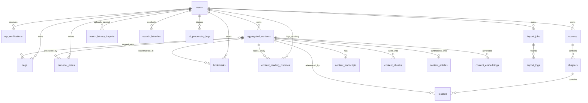

# AmarSocialContent - Database Design & Schema Specification

## 1. Entity-Relationship Diagram (ERD)

---

## 2. Table Schemas & Definitions

### 2.1 Authentication & User Management

#### `users`
| Column | Type | Constraints | Description |
|---|---|---|---|
| `id` | BIGINT UNSIGNED | PK, AUTO_INCREMENT | Unique user identifier |
| `name` | VARCHAR(120) | NOT NULL | User's full name |
| `email` | VARCHAR(191) | NOT NULL, UNIQUE | User's registered email |
| `role` | ENUM('user', 'admin') | NOT NULL, DEFAULT 'user' | Access control role |
| `is_active` | BOOLEAN | NOT NULL, DEFAULT TRUE | Account state |
| `email_verified_at` | TIMESTAMP | NULLABLE | Verification timestamp |
| `remember_token` | VARCHAR(100) | NULLABLE | Session remember token |
| `created_at` | TIMESTAMP | NULLABLE | Creation timestamp |
| `updated_at` | TIMESTAMP | NULLABLE | Update timestamp |

#### `otp_verifications`
| Column | Type | Constraints | Description |
|---|---|---|---|
| `id` | BIGINT UNSIGNED | PK, AUTO_INCREMENT | Record ID |
| `email` | VARCHAR(191) | NOT NULL, INDEX | Target recipient email |
| `otp_hash` | VARCHAR(255) | NOT NULL | Securely hashed 6-digit OTP code |
| `attempts` | TINYINT UNSIGNED | NOT NULL, DEFAULT 0 | Failed verification attempt counter |
| `expires_at` | TIMESTAMP | NOT NULL | Expiry time (5 minutes from generation) |
| `verified_at` | TIMESTAMP | NULLABLE | Timestamp when successfully verified |
| `created_at` | TIMESTAMP | NULLABLE | Creation timestamp |

---

### 2.2 Content Aggregation & Storage

#### `aggregated_contents`
| Column | Type | Constraints | Description |
|---|---|---|---|
| `id` | BIGINT UNSIGNED | PK, AUTO_INCREMENT | Aggregation primary key |
| `user_id` | BIGINT UNSIGNED | NOT NULL, FK(`users.id`), CASCADE | Owner ID |
| `youtube_video_id` | VARCHAR(64) | NOT NULL | Extracted YouTube video ID |
| `youtube_url` | VARCHAR(512) | NOT NULL | Original submitted video URL |
| `title` | VARCHAR(255) | NOT NULL | Original video title |
| `bengali_title` | VARCHAR(255) | NULLABLE | AI-generated Bengali title |
| `channel_name` | VARCHAR(191) | NULLABLE | YouTube channel title |
| `thumbnail_url` | VARCHAR(512) | NULLABLE | Video thumbnail URL |
| `duration_seconds` | INT UNSIGNED | NULLABLE | Video duration in seconds |
| `published_at` | TIMESTAMP | NULLABLE | Video original publish date |
| `content_type` | ENUM('short', 'video') | NOT NULL, DEFAULT 'video' | Detected YouTube format |
| `visibility` | ENUM('private', 'public') | NOT NULL, DEFAULT 'private' | Content visibility state |
| `share_token` | VARCHAR(64) | NULLABLE, UNIQUE | Random cryptographic slug for public sharing |
| `status` | ENUM('pending', 'extracting_transcript', 'processing_transcript', 'generating_bengali', 'generating_embeddings', 'completed', 'failed') | NOT NULL, DEFAULT 'pending' | Processing lifecycle |
| `error_message` | TEXT | NULLABLE | Detailed error if processing fails |
| `ai_provider` | VARCHAR(64) | NULLABLE | Provider used (gemini/groq) |
| `ai_model` | VARCHAR(64) | NULLABLE | Model version used |
| `reading_time_minutes` | SMALLINT UNSIGNED | DEFAULT 1 | Estimated reading time in Bengali |
| `created_at` | TIMESTAMP | NULLABLE | Creation timestamp |
| `updated_at` | TIMESTAMP | NULLABLE | Update timestamp |
| `deleted_at` | TIMESTAMP | NULLABLE | Soft delete timestamp |

*Indexes*:
- `INDEX(user_id, status)`
- `INDEX(user_id, youtube_video_id)`
- `UNIQUE(share_token)`

#### `content_transcripts`
| Column | Type | Constraints | Description |
|---|---|---|---|
| `id` | BIGINT UNSIGNED | PK, AUTO_INCREMENT | Transcript ID |
| `aggregated_content_id`| BIGINT UNSIGNED | NOT NULL, FK(`aggregated_contents.id`), CASCADE, UNIQUE | Associated article |
| `full_transcript` | LONGTEXT | NOT NULL | Complete raw transcript text |
| `language` | VARCHAR(16) | NOT NULL, DEFAULT 'en' | Transcript language code |
| `is_manual` | BOOLEAN | NOT NULL, DEFAULT FALSE | Whether submitted manually by user |
| `created_at` | TIMESTAMP | NULLABLE | Creation timestamp |

#### `content_chunks`
| Column | Type | Constraints | Description |
|---|---|---|---|
| `id` | BIGINT UNSIGNED | PK, AUTO_INCREMENT | Chunk ID |
| `aggregated_content_id`| BIGINT UNSIGNED | NOT NULL, FK(`aggregated_contents.id`), CASCADE | Associated article |
| `chunk_index` | SMALLINT UNSIGNED| NOT NULL | Sequential chunk order (0, 1, 2...) |
| `original_text` | MEDIUMTEXT | NOT NULL | Raw transcript chunk |
| `translated_text` | MEDIUMTEXT | NULLABLE | Bengali translated/processed chunk |
| `token_count` | INT UNSIGNED | DEFAULT 0 | Estimated token count |
| `created_at` | TIMESTAMP | NULLABLE | Creation timestamp |

*Indexes*:
- `INDEX(aggregated_content_id, chunk_index)`

#### `content_articles`
| Column | Type | Constraints | Description |
|---|---|---|---|
| `id` | BIGINT UNSIGNED | PK, AUTO_INCREMENT | Article ID |
| `aggregated_content_id`| BIGINT UNSIGNED | NOT NULL, FK(`aggregated_contents.id`), CASCADE, UNIQUE | Parent content |
| `introduction` | TEXT | NULLABLE | Bengali overview & context |
| `main_discussion` | LONGTEXT | NOT NULL | Comprehensive mentor-style discussion |
| `important_concepts` | TEXT | NULLABLE | Key concepts explained |
| `examples_applications`| TEXT | NULLABLE | Practical examples & case studies |
| `takeaways` | TEXT | NULLABLE | Key lessons and actionable insights |
| `key_terms` | TEXT | NULLABLE | English terms & Bengali definitions |
| `raw_markdown` | LONGTEXT | NOT NULL | Complete combined article in Markdown |
| `created_at` | TIMESTAMP | NULLABLE | Creation timestamp |
| `updated_at` | TIMESTAMP | NULLABLE | Update timestamp |

*Indexes*:
- `FULLTEXT(raw_markdown)`

---

### 2.3 Learning Management System (LMS)

#### `courses`
| Column | Type | Constraints | Description |
|---|---|---|---|
| `id` | BIGINT UNSIGNED | PK, AUTO_INCREMENT | Course ID |
| `user_id` | BIGINT UNSIGNED | NOT NULL, FK(`users.id`), CASCADE | Course Owner |
| `title` | VARCHAR(255) | NOT NULL | Course Title |
| `slug` | VARCHAR(255) | NOT NULL | URL-friendly slug |
| `description` | TEXT | NULLABLE | Course description |
| `cover_image` | VARCHAR(512) | NULLABLE | Path or URL to course cover |
| `visibility` | ENUM('private', 'public') | NOT NULL, DEFAULT 'private' | Visibility status |
| `sort_order` | INT UNSIGNED | NOT NULL, DEFAULT 0 | Ordering in library |
| `created_at` | TIMESTAMP | NULLABLE | Creation timestamp |
| `updated_at` | TIMESTAMP | NULLABLE | Update timestamp |

*Indexes*:
- `INDEX(user_id, sort_order)`
- `UNIQUE(user_id, slug)`

#### `chapters`
| Column | Type | Constraints | Description |
|---|---|---|---|
| `id` | BIGINT UNSIGNED | PK, AUTO_INCREMENT | Chapter ID |
| `course_id` | BIGINT UNSIGNED | NOT NULL, FK(`courses.id`), CASCADE | Parent Course |
| `title` | VARCHAR(255) | NOT NULL | Chapter Title |
| `description` | TEXT | NULLABLE | Chapter description |
| `sort_order` | INT UNSIGNED | NOT NULL, DEFAULT 0 | Chapter sequence |
| `created_at` | TIMESTAMP | NULLABLE | Creation timestamp |
| `updated_at` | TIMESTAMP | NULLABLE | Update timestamp |

*Indexes*:
- `INDEX(course_id, sort_order)`

#### `lessons`
| Column | Type | Constraints | Description |
|---|---|---|---|
| `id` | BIGINT UNSIGNED | PK, AUTO_INCREMENT | Lesson ID |
| `chapter_id` | BIGINT UNSIGNED | NOT NULL, FK(`chapters.id`), CASCADE | Parent Chapter |
| `aggregated_content_id`| BIGINT UNSIGNED | NULLABLE, FK(`aggregated_contents.id`), SET NULL | Referenced article |
| `title` | VARCHAR(255) | NOT NULL | Lesson Title |
| `content` | LONGTEXT | NULLABLE | Independent lesson notes/content |
| `sort_order` | INT UNSIGNED | NOT NULL, DEFAULT 0 | Lesson sequence |
| `visibility` | ENUM('private', 'public') | NOT NULL, DEFAULT 'private' | Visibility status |
| `is_completed` | BOOLEAN | NOT NULL, DEFAULT FALSE | Completion status |
| `created_at` | TIMESTAMP | NULLABLE | Creation timestamp |
| `updated_at` | TIMESTAMP | NULLABLE | Update timestamp |

*Indexes*:
- `INDEX(chapter_id, sort_order)`
- `INDEX(aggregated_content_id)`

---

### 2.4 Tags & User Annotations

#### `tags`
| Column | Type | Constraints | Description |
|---|---|---|---|
| `id` | BIGINT UNSIGNED | PK, AUTO_INCREMENT | Tag ID |
| `user_id` | BIGINT UNSIGNED | NOT NULL, FK(`users.id`), CASCADE | Owner User |
| `name` | VARCHAR(64) | NOT NULL | Tag name |
| `slug` | VARCHAR(64) | NOT NULL | Slugified name |
| `created_at` | TIMESTAMP | NULLABLE | Creation timestamp |
| `updated_at` | TIMESTAMP | NULLABLE | Update timestamp |

*Indexes*:
- `UNIQUE(user_id, slug)`

#### `aggregated_content_tag`
| Column | Type | Constraints | Description |
|---|---|---|---|
| `id` | BIGINT UNSIGNED | PK, AUTO_INCREMENT | Pivot ID |
| `aggregated_content_id`| BIGINT UNSIGNED | NOT NULL, FK(`aggregated_contents.id`), CASCADE | Content ID |
| `tag_id` | BIGINT UNSIGNED | NOT NULL, FK(`tags.id`), CASCADE | Tag ID |

*Indexes*:
- `UNIQUE(aggregated_content_id, tag_id)`

#### `personal_notes`
| Column | Type | Constraints | Description |
|---|---|---|---|
| `id` | BIGINT UNSIGNED | PK, AUTO_INCREMENT | Note ID |
| `user_id` | BIGINT UNSIGNED | NOT NULL, FK(`users.id`), CASCADE | Owner User |
| `aggregated_content_id`| BIGINT UNSIGNED | NOT NULL, FK(`aggregated_contents.id`), CASCADE | Annotated Article |
| `note_content` | MEDIUMTEXT | NOT NULL | Private user note |
| `created_at` | TIMESTAMP | NULLABLE | Creation timestamp |
| `updated_at` | TIMESTAMP | NULLABLE | Update timestamp |

*Indexes*:
- `INDEX(user_id, aggregated_content_id)`

#### `bookmarks`
| Column | Type | Constraints | Description |
|---|---|---|---|
| `id` | BIGINT UNSIGNED | PK, AUTO_INCREMENT | Bookmark ID |
| `user_id` | BIGINT UNSIGNED | NOT NULL, FK(`users.id`), CASCADE | Owner User |
| `aggregated_content_id`| BIGINT UNSIGNED | NOT NULL, FK(`aggregated_contents.id`), CASCADE | Bookmarked Article |
| `created_at` | TIMESTAMP | NULLABLE | Creation timestamp |

*Indexes*:
- `UNIQUE(user_id, aggregated_content_id)`

#### `content_reading_histories`
| Column | Type | Constraints | Description |
|---|---|---|---|
| `id` | BIGINT UNSIGNED | PK, AUTO_INCREMENT | History ID |
| `user_id` | BIGINT UNSIGNED | NOT NULL, FK(`users.id`), CASCADE | Owner User |
| `aggregated_content_id`| BIGINT UNSIGNED | NOT NULL, FK(`aggregated_contents.id`), CASCADE | Read Content |
| `seconds_spent` | INT UNSIGNED | NOT NULL, DEFAULT 0 | Active study/reading duration in seconds |
| `is_completed` | BOOLEAN | NOT NULL, DEFAULT FALSE | Whether marked or read through to completion |
| `last_read_at` | TIMESTAMP | NOT NULL | Last accessed/read timestamp |
| `view_count` | INT UNSIGNED | NOT NULL, DEFAULT 1 | Total read/open count |
| `created_at` | TIMESTAMP | NULLABLE | Creation timestamp |
| `updated_at` | TIMESTAMP | NULLABLE | Update timestamp |

*Indexes*:
- `UNIQUE(user_id, aggregated_content_id)`
- `INDEX(user_id, last_read_at)`

#### `watch_history_imports`
| Column | Type | Constraints | Description |
|---|---|---|---|
| `id` | BIGINT UNSIGNED | PK, AUTO_INCREMENT | Import Batch ID |
| `user_id` | BIGINT UNSIGNED | NOT NULL, FK(`users.id`), CASCADE | Owner User |
| `source_format` | ENUM('google_takeout_json', 'google_takeout_html', 'csv') | NOT NULL | Uploaded file type |
| `file_name` | VARCHAR(255) | NOT NULL | Original uploaded filename |
| `total_discovered` | INT UNSIGNED | NOT NULL, DEFAULT 0 | Total YouTube videos discovered in file |
| `selected_count` | INT UNSIGNED | NOT NULL, DEFAULT 0 | Number of videos selected by user |
| `imported_count` | INT UNSIGNED | NOT NULL, DEFAULT 0 | Successfully aggregated into library |
| `status` | ENUM('uploaded', 'parsed', 'processing', 'completed', 'failed') | NOT NULL, DEFAULT 'uploaded' | Import state |
| `created_at` | TIMESTAMP | NULLABLE | Upload timestamp |
| `updated_at` | TIMESTAMP | NULLABLE | Update timestamp |

*Indexes*:
- `INDEX(user_id, status)`

---

### 2.5 Semantic Embeddings & Search

#### `content_embeddings`
| Column | Type | Constraints | Description |
|---|---|---|---|
| `id` | BIGINT UNSIGNED | PK, AUTO_INCREMENT | Embedding ID |
| `aggregated_content_id`| BIGINT UNSIGNED | NOT NULL, FK(`aggregated_contents.id`), CASCADE | Associated article |
| `content_chunk_id` | BIGINT UNSIGNED | NULLABLE, FK(`content_chunks.id`), CASCADE | Specific chunk (if applicable) |
| `embedding_vector` | JSON | NOT NULL | 768-dimensional float array |
| `dimensions` | SMALLINT UNSIGNED| NOT NULL, DEFAULT 768 | Vector dimensionality |
| `model_name` | VARCHAR(64) | NOT NULL, DEFAULT 'text-embedding-004' | Embedding model |
| `created_at` | TIMESTAMP | NULLABLE | Creation timestamp |

*Indexes*:
- `INDEX(aggregated_content_id)`

#### `search_histories`
| Column | Type | Constraints | Description |
|---|---|---|---|
| `id` | BIGINT UNSIGNED | PK, AUTO_INCREMENT | Search query ID |
| `user_id` | BIGINT UNSIGNED | NOT NULL, FK(`users.id`), CASCADE | Searching user |
| `query` | VARCHAR(255) | NOT NULL | Search text query |
| `search_type` | ENUM('hybrid', 'semantic', 'fulltext') | NOT NULL, DEFAULT 'hybrid' | Execution method |
| `results_count` | INT UNSIGNED | NOT NULL, DEFAULT 0 | Match count |
| `created_at` | TIMESTAMP | NULLABLE | Search timestamp |

*Indexes*:
- `INDEX(user_id, created_at)`

---

### 2.6 AI Processing Logs, Activity & Migration

#### `ai_processing_logs`
| Column | Type | Constraints | Description |
|---|---|---|---|
| `id` | BIGINT UNSIGNED | PK, AUTO_INCREMENT | Log ID |
| `user_id` | BIGINT UNSIGNED | NOT NULL, FK(`users.id`), CASCADE | Requesting user |
| `aggregated_content_id`| BIGINT UNSIGNED | NULLABLE, FK(`aggregated_contents.id`), SET NULL | Target content |
| `provider` | VARCHAR(32) | NOT NULL | gemini / groq |
| `model` | VARCHAR(64) | NOT NULL | Model identifier |
| `operation_type` | VARCHAR(32) | NOT NULL | generate_article / embedding |
| `prompt_tokens` | INT UNSIGNED | DEFAULT 0 | Token tally |
| `completion_tokens` | INT UNSIGNED | DEFAULT 0 | Token tally |
| `latency_ms` | INT UNSIGNED | DEFAULT 0 | Request duration |
| `status` | ENUM('success', 'failed', 'fallback_triggered') | NOT NULL | Outcome |
| `error_details` | TEXT | NULLABLE | Error message / trace |
| `created_at` | TIMESTAMP | NULLABLE | Log timestamp |

#### `import_jobs`
| Column | Type | Constraints | Description |
|---|---|---|---|
| `id` | BIGINT UNSIGNED | PK, AUTO_INCREMENT | Job ID |
| `user_id` | BIGINT UNSIGNED | NOT NULL, FK(`users.id`), CASCADE | Executing user |
| `source_table` | VARCHAR(120) | NOT NULL | Legacy source table name |
| `total_records` | INT UNSIGNED | NOT NULL, DEFAULT 0 | Total records discovered |
| `processed_records` | INT UNSIGNED | NOT NULL, DEFAULT 0 | Processed count |
| `success_count` | INT UNSIGNED | NOT NULL, DEFAULT 0 | Successfully imported |
| `duplicate_count` | INT UNSIGNED | NOT NULL, DEFAULT 0 | Skipped duplicates |
| `failed_count` | INT UNSIGNED | NOT NULL, DEFAULT 0 | Failed count |
| `status` | ENUM('pending', 'running', 'completed', 'failed') | NOT NULL, DEFAULT 'pending' | Execution state |
| `created_at` | TIMESTAMP | NULLABLE | Created timestamp |
| `updated_at` | TIMESTAMP | NULLABLE | Updated timestamp |

#### `import_logs`
| Column | Type | Constraints | Description |
|---|---|---|---|
| `id` | BIGINT UNSIGNED | PK, AUTO_INCREMENT | Log item ID |
| `import_job_id` | BIGINT UNSIGNED | NOT NULL, FK(`import_jobs.id`), CASCADE | Parent Job |
| `external_id` | VARCHAR(120) | NULLABLE | External video/row ID |
| `status` | ENUM('imported', 'duplicate_skipped', 'failed') | NOT NULL | Outcome |
| `message` | TEXT | NULLABLE | Detail notes |
| `raw_data` | JSON | NULLABLE | Raw row snapshot |
| `created_at` | TIMESTAMP | NULLABLE | Created timestamp |

#### `activity_logs`
| Column | Type | Constraints | Description |
|---|---|---|---|
| `id` | BIGINT UNSIGNED | PK, AUTO_INCREMENT | Activity ID |
| `user_id` | BIGINT UNSIGNED | NOT NULL, FK(`users.id`), CASCADE | Actor ID |
| `action` | VARCHAR(64) | NOT NULL | Action key (e.g., article_created) |
| `entity_type` | VARCHAR(64) | NOT NULL | Model class name |
| `entity_id` | BIGINT UNSIGNED | NOT NULL | Model ID |
| `ip_address` | VARCHAR(45) | NULLABLE | Request IP |
| `user_agent` | VARCHAR(255) | NULLABLE | Request user agent |
| `created_at` | TIMESTAMP | NULLABLE | Creation timestamp |

---

## 3. High-Concurrency Redis Caching & Queue Design (1000+ Concurrent Users)

To ensure sub-100ms response times and prevent MySQL bottlenecks under 1000+ concurrent users:

### 3.1 Redis Cache Key Taxonomy
| Key Pattern | Data Structure | TTL | Purpose |
|---|---|---|---|
| `user:{id}:dashboard_stats` | String (JSON) | 10 minutes | Total articles, courses, completed lessons, read streak |
| `user:{id}:recent_reading` | List / JSON | 15 minutes | User's recent reading timeline |
| `article:public:{share_token}`| String (JSON) | 1 hour | Quarantined public article payload |
| `article:{id}:rendered` | String (HTML) | 24 hours | Rendered Markdown HTML (invalidated on article update) |
| `search:{user_id}:{md5_query}`| String (JSON) | 10 minutes | Cached semantic and full-text search results |
| `ratelimit:otp:{ip_or_email}` | String (Counter)| 1 hour | Atomic OTP generation rate-limiting |

### 3.2 Redis Queue Workers
- Queue `default`: Light jobs (email dispatch, activity logging).
- Queue `ai-processing`: Heavy AI jobs (`ProcessYouTubeVideoJob`, `BengaliSynthesisJob`).
- Queue `imports`: Batch parsing (`ParseGoogleTakeoutJob`, `ImportWatchHistoryJob`).
- Queue `embeddings`: Vector generation (`GenerateEmbeddingsJob`).

